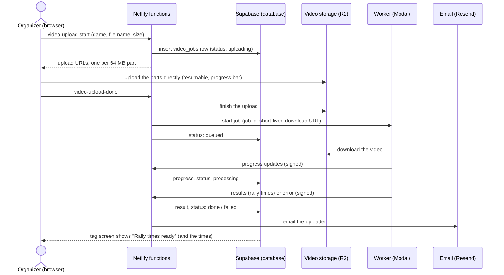

# Video analysis in SetMe: architecture

An organizer uploads a game's video in SetMe. It's analysed in the background (rally times now; ball positions,
who won each point and in/out calls later), and the person who uploaded it is told when the results are ready. The
results then appear on that game's tag screen without anyone loading a file.

Status: proposal. Nothing here is built yet. The analysis itself exists (`vision/`, run by hand on a laptop).

## The decision this needs first

SetMe's rule so far is that **game video never leaves the device** (`supabase/match_stats.sql`, the tag screen's
"It never leaves this device"). Uploading reverses it. Video shows people's faces and bodies, so before building:

- **Consent:** players are told games may be filmed and analysed; anyone can ask to be left out of filmed games.
- **Retention:** the video is deleted a set time after analysis (proposed: 7 days); only the results (rally times,
  later ball positions) are kept. Nobody can download another person's upload.
- **Who can upload:** organizers and the super only, as with tagging.

Record the choice in `docs/decisions.md` either way.

## How it works



### The pieces

| Piece | What it does | Choice | Why |
|---|---|---|---|
| Upload | Browser sends the file straight to storage, in parts, so a dropped connection resumes instead of starting over | Cloudflare R2, S3 multipart with presigned URLs | 2 GB files never pass through Netlify (functions cap request bodies at a few MB). R2 has no download (egress) fees and 10 GB free |
| Job record | One row per upload: who, which game, status, progress, result, error | New `video_jobs` table in Supabase | Same database, same sign-in and row-level security as the rest of SetMe |
| Start / finish / callbacks | Check the caller is an organizer, hand out upload URLs, start the worker, take its updates | 3 new Netlify functions | Same pattern as `build-teams`; the Supabase service key stays in Netlify |
| Analysis | Runs `setme_vision` on the video | Modal (serverless Python), CPU now, GPU once the trained detector exists | Starts in seconds, bills by the second, nothing to run when idle. The worker gets only a download URL and a callback secret, never the Supabase key |
| Telling the uploader | Email with a link to the game's tag screen, plus the status on the tag screen itself | Resend (email); Supabase Realtime or polling on the page | 3,000 free emails a month covers a club many times over |
| Clean-up | Deletes videos past the retention time; fails jobs stuck over an hour | Netlify scheduled function, daily | Keeps storage near zero and the promise to players |

### `video_jobs`

```sql
create table public.video_jobs (
  id uuid primary key default gen_random_uuid(),
  game_id bigint not null references public.games on delete cascade,
  uploaded_by uuid not null default auth.uid(),
  file_name text not null,               -- also becomes games.video_ref, so tags still match by name
  size_bytes bigint not null,
  storage_key text,                      -- where the video sits in R2; null once deleted
  status text not null default 'uploading'
    check (status in ('uploading', 'queued', 'processing', 'done', 'failed', 'cancelled')),
  progress real,                         -- 0 to 1 while processing
  result jsonb,                          -- { version, rallies: [{ start, end, confidence }] }, the same as game.rallies.json
  error text,                            -- for people: "The video couldn't be read. Try exporting it again as MP4."
  attempts smallint not null default 0,
  created_at timestamptz not null default now(),
  finished_at timestamptz,
  video_deleted_at timestamptz
);
-- Read: the uploader, organizers and the super. Write: only the Netlify functions (service key).
```

### What changes in the app

- **Tag screen:** an "Upload for analysis" button next to Open video file, with a progress bar that survives a
  page reload (the upload resumes from the parts already sent), then "Analysing… 40%", then the rally times load by
  themselves: Next rally (N) works as it does with a loaded file today. Load rally times stays for the laptop tool.
- **Games list:** a small status per game (uploading, analysing, ready, failed).
- **Email to the uploader:** "Rally times are ready for Game 2 on Tuesday, Nov 10: 41 rallies found. Open the tag
  screen: <link>". On failure, what went wrong and what to try.

### Failure and edge cases

- **Upload interrupted:** parts already sent are kept; the page offers Resume. Unfinished uploads are cleaned up
  after a day (an R2 lifecycle rule).
- **Worker crashes or times out:** retried twice, then `failed` with a plain message. A job with no update for an
  hour is marked failed by the daily clean-up.
- **Same video uploaded twice:** the second upload for a game replaces the first job after asking.
- **Unreadable video** (wrong codec, corrupted): fails fast with "Export it again as MP4" rather than hanging.
- **Too big:** limit 4 GB (about 45 minutes of iPhone 1080p video). Checked before the upload starts.
- **Security:** upload and download URLs expire (1 hour); the storage bucket isn't public; the worker's callbacks
  are signed with a shared secret and checked in Netlify; only organizers and the super can start an upload.

## Pricing

Prices are list prices as last known (2025 to mid-2026). Check each provider's pricing page before signing up; the
totals are small enough that a change won't alter the choice.

### Per game (a 20-minute, 1.3 to 2 GB iPhone video)

| | Now (colour detector, CPU) | Later (trained detector, GPU) |
|---|---|---|
| Compute | 4 CPU cores for about 10 minutes: about $0.03 | 1 small GPU (NVIDIA T4) for about 10 minutes: about $0.10 |
| Memory | 8 GB for 10 minutes: about $0.01 | about $0.01 |
| Storage | 2 GB for 7 days: under $0.01 | the same |
| Upload and download | $0 (R2 has no egress fees; uploads are free) | $0 |
| Email | $0 | $0 |
| **Total** | **about $0.05** | **about $0.12** |

Rates used: Modal CPU about $0.047 per core-hour, memory about $0.008 per GB-hour, T4 GPU about $0.59 per hour;
R2 $0.015 per GB-month.

### Per month

| | 3 games a week (~13 a month) | 10 games a week (~43 a month) |
|---|---|---|
| Analysis (Modal) | $0.70 to $1.60 | $2 to $5 |
| Modal's free monthly credit ($30 on the Starter plan) | covers it: **$0** | covers it: **$0** |
| Video storage (R2, 7-day retention) | ~6 GB, inside the 10 GB free: **$0** | ~20 GB: **about $0.15** |
| Email (Resend free plan) | $0 | $0 |
| Netlify functions | inside the current plan | inside the current plan |
| Supabase | no change (no large files go through it) | no change |
| **Total** | **$0** | **under $1** |

Without Modal's free credit the worst case is about $5 a month. Keeping videos instead of deleting them adds about
$0.03 per game per month in R2 (10 games a week kept for a year: about 1 TB, about $15 a month).

### The alternative that costs more

Storing video in **Supabase Storage** instead of R2 keeps everything in one place, but the free plan limits files to
50 MB, so it needs **Supabase Pro at $25 a month** (100 GB storage and 250 GB of downloads included, then about
$0.02 per GB stored and $0.09 per GB downloaded). Worth it only if SetMe moves to Pro for other reasons.

### Other worker options

| Option | Cost at this volume | Trade-off |
|---|---|---|
| **Modal** (recommended) | $0 to $5 a month | Python-native, GPU when needed, scales to zero. Another account to manage |
| Google Cloud Run Jobs | about $0 (generous free tier) | Needs a container image and Google Cloud setup; GPU is more work |
| A small always-on server (e.g. Hetzner, 4 cores) | about $8 a month flat | Simplest mentally, but you patch and monitor it, and no GPU at that price |
| Your own laptop (today) | $0 | Someone has to run it; nothing happens in the background |

## Upload time is the real cost

A 2 GB file at a typical 20 Mbit/s home upload takes about **13 minutes**; on phone data it's slower and uses the
allowance. So: upload from Wi-Fi, keep the page open (or come back: it resumes), and the email arrives about 15
minutes after the upload finishes. Shrinking the video in the browser first would save time but costs accuracy (the
ball is only a few pixels across from far back), so it isn't proposed.

## Building it, in order

1. **Decide on upload and retention** (above), and add the consent note for players.
2. **Accounts:** Cloudflare R2 bucket, Modal, Resend. Their keys go in Netlify's environment variables only.
3. **Database:** `video_jobs` table and its row-level security (one SQL file, run once, like the others).
4. **Netlify functions:** `video-upload-start`, `video-upload-done`, `video-job-update` (worker callbacks), and the
   daily clean-up.
5. **Worker:** a Modal app wrapping `setme_vision` (download, analyse, report progress, post the result).
6. **Tag screen:** Upload for analysis, progress, status, rally times loaded from the job.
7. **Email** on done and failed.
8. **Tests:** the job state changes and the signed callbacks; an end-to-end run with a short test video.

Rough effort: 2 to 3 working sessions, most of it in steps 4 to 6.

## Later, on the same pipeline

- **Trained ball detector:** swap the worker to a GPU and a new `detect.py`; nothing else changes (about $0.12 a
  game).
- **Who won each point:** where the ball lands, pre-filled on the tag screen for the tagger to confirm.
- **In/out calls:** the court lines marked once per camera spot, the landing point checked against them; "in",
  "out" or "too close to call".
